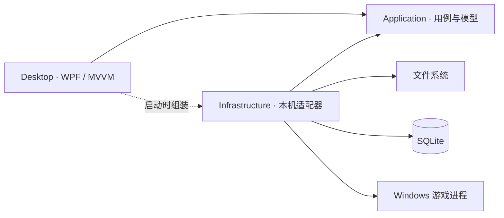
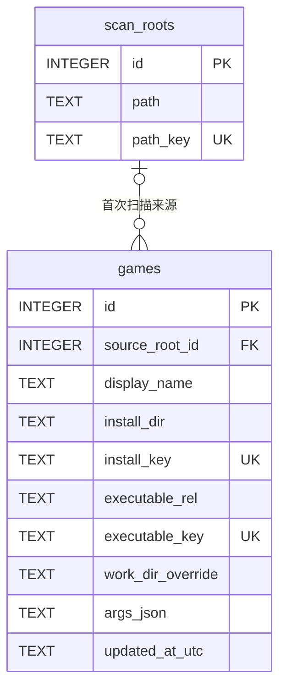

# Galgame 管理器系统设计文档

| 版本 | 日期 | 对应交付 |
| --- | --- | --- |
| v0.1 | 2026-11-20 | Windows 桌面应用 MVP |

本应用为已经下载并解压或安装到本地的 Galgame 建立游戏库。玩家选择一个或多个目录，预览识别结果并导入。游戏库和启动配置存储在本机，玩家以后可以在游戏库中搜索并一键启动游戏。

[开发计划](开发计划.md)

## 1 功能范围与验收目标

| 编号 | 功能 | 验收目标 |
| --- | --- | --- |
| R01 | 扫描目录 | 可添加多个目录，手动扫描单个目录或全部目录，查看进度并取消。子目录读失败时仍能得到其他目录的结果。 |
| R02 | 识别和导入 | 同一游戏目录归为一条导入项。明确的入口可预选，多入口可手选，漏扫的游戏可手动添加。 |
| R03 | 游戏库 | 导入后立即可见，可按显示名称搜索。关闭应用再打开后，游戏和扫描目录仍可用。 |
| R04 | 一键启动 | 具有有效配置的游戏可直接启动。运行进程收到正确的执行文件路径、工作目录和参数。 |
| R05 | 编辑和重新定位 | 可修改显示名称、启动入口、工作目录和参数。文件迁移或移动盘断开后仍能看到原记录，可在应用内重新定位。 |
| R06 | 重复扫描 | 同一安装路径重复扫描或被重叠的扫描目录覆盖时，已有记录和用户设置继续有效。 |
| R07 | Windows 10 和 11 | 在 Windows 10 22H2 x64 和 Windows 11 x64 上验证同一自包含发布包的扫描、持久化和启动流程。 |

首版聚焦离线管理，扫描对象为本地固定盘和已连接的可移动盘上的 Windows `.exe` 游戏。在线资料、云同步、下载和解压归入后续版本。旧游戏自身需要的日文区域设置、运行库等由游戏运行环境决定，首版提供自定义启动参数和工作目录。

## 2 总体架构

应用采用 C#、.NET 10 LTS 和 WPF。WPF 使用 MVVM 组织屏幕状态和命令。SQLite 通过 `Microsoft.Data.Sqlite` 持久化数据。整个应用在一个 Windows 桌面进程内运行，由 Windows 创建独立的游戏进程。



Desktop 在应用启动时组装 Infrastructure 实现，之后 ViewModel 通过 Application 用例发起操作。Infrastructure 实现应用层定义的接口，Application 可以独立测试。

| 项目 | 模块 | 职责 |
| --- | --- | --- |
| `GalgameManager.Desktop` | 游戏库、扫描目录、导入预览、游戏详情 | 文件夹和文件选择、视图绑定、搜索和筛选、进度与错误提示。 |
| `GalgameManager.Application` | 游戏库服务、导入服务、启动服务 | 调度扫描和评分、校验并导入用户选择、管理启动配置、翻译错误和维护状态。 |
| `GalgameManager.Infrastructure` | 文件遍历、SQLite 仓储、进程启动 | 读取目录和文件属性，执行迁移和事务，调用 Windows 进程启动能力。 |

应用启动时执行数据库初始化或迁移，再加载游戏库。桌面线程负责界面绑定，文件遍历和 SQLite 操作交给后台工作线程。首版限制每个 Windows 用户同时打开一个应用实例，进程内同时运行一项扫描，数据库写操作串行执行。单次遍历完成后才开始导入事务，避免在扫描或等待玩家确认时持有事务。

Windows 10 的首版兼容目标为 **22H2 x64（19045）**。构建目标使用 `net10.0-windows`，首版使用 WPF 和 Windows 10 可用的系统能力。微软当前的 .NET 10 支持清单包含 Windows 10 Enterprise LTSC 2021 等仍受支持的版本。家庭版和专业版 22H2 的应用兼容性以发布包实测为准。 [微软 .NET 10 支持清单][dotnet-os] · [Windows 10 生命周期][windows-life]

## 3 界面与交互设计

| 界面 | 主要操作 | 状态与反馈 |
| --- | --- | --- |
| 游戏库 | 搜索、启动、打开详情、手动添加 | 首次使用引导添加目录。空搜索结果、待配置、路径不可用各有对应提示。 |
| 扫描目录 | 添加或移除目录、扫描单个或全部目录、取消扫描 | 显示当前目录、已遍历目录数、发现的候选数和跳过项。总量未知时用不定进度。 |
| 导入预览 | 查看新发现和已有游戏，勾选导入项，选择入口 | 入口明确时预选。入口不明确时可手选，或以待配置状态入库。已有记录默认不参与批量导入。 |
| 游戏详情 | 编辑名称、入口、工作目录和参数，重新定位游戏 | 用文件选择器替换入口。工作目录留空时使用入口所在目录。启动参数按参数项录入，避免混淆空格与引号。 |

游戏库先加载保存的名称和配置，再在后台检查入口及工作目录。安装目录不可访问时显示「路径不可用」。安装目录可用且尚未选入口时显示「待配置」。只有入口和工作目录均可访问时才显示「已就绪」。列表在打开、导入、保存和手动刷新时更新状态，点击启动时再次核验。

## 4 目录扫描与入口识别

### 4.1 遍历和归组

1. 通过系统目录选择器接收目录。将路径转换为规范的绝对路径，统一分隔符和末尾分隔符。对默认采用大小写不敏感比较的 Windows 路径，使用同一规则生成去重键，原始大小写用于展示。按完整路径段判断包含关系。
2. 在后台逐层枚举目录和 `.exe`，每进入一个目录检查取消令牌。跳过自动遍历遇到的目录联接、符号链接等重解析点。记录访问被拒绝、目录在扫描中消失等问题，继续处理其他分支。扫描全部目录时，共享本次已枚举目录集合，避免重复访问重叠范围。
3. 收集本批次全部候选后再归组，默认取可执行文件的父目录。遇到连续的 `bin`、`x64`、`x86`、`Win64` 等程序子目录时，向上折叠到最近的非程序目录，归组路径须位于本批次的扫描范围内。按安装路径和已有游戏的启动文件查重，匹配的分组显示为已入库。
4. 对每组候选排序并生成预览。默认标题取归组目录名。扫描器只读取文件系统信息，实际执行由玩家点击游戏库的「启动」后触发。

### 4.2 初始评分规则

| 线索 | 处理 |
| --- | --- |
| 文件名符合安装、卸载、配置或崩溃报告工具的明确命名，如 `setup.exe`、`unins000.exe`、`config.exe` | 标为辅助程序，从自动建议中排除。只有辅助程序的目录默认不生成游戏项，玩家可手动指定入口。 |
| 文件主名与归组目录名一致 | 加 4 分。 |
| 入口所在目录有同名的 `<文件主名>_Data` 目录，或归组目录直接包含 `.xp3` 等已知资源文件 | 加 3 分，每个候选最多计一次。归组目录取证过于宽泛时，可根据样本收紧规则。 |
| 文件直接位于归组目录 | 加 1 分。 |
| 多个候选分数相近 | 按分数和路径稳定排序，交由玩家选择。 |

初始自动建议条件为最高分至少 4 分，且比次高分至少多 2 分。只有一个候选时仍须达到 4 分。用户可在预览中改选，或者将游戏作为待配置条目导入。开发阶段用样本目录校准分数，低置信度结果始终可人工处理。

### 4.3 提交和重复扫描

扫描产生内存中的预览。导入时校验条目选择、选定入口是否存在及是否属于对应游戏目录。若预览期间文件移动，暂停本批次，提示受影响的条目并保留当前选择。通过校验的批次在一次 SQLite 事务中提交，事务内按已有启动文件路径和安装目录键去重，并返回新增及跳过数量。

用户取消扫描或关闭预览时，已保存的扫描目录仍可用于下次扫描。重新扫描只添加确认的新游戏，已保存的名称、入口、参数和工作目录由详情页管理。扫描范围不可访问或未发现原目录时，保留原游戏条目，路径可用性根据文件系统检查结果显示。

## 5 启动与路径修复

1. 启动服务按游戏 ID 读取配置。将游戏目录与相对入口合成为绝对路径，并验证路径范围、`.exe` 后缀和文件存在性。核验工作目录是否可访问，确定参数数组。
2. 使用 `ProcessStartInfo` 启动。将执行文件绝对路径传给 `FileName`，设置 `UseShellExecute = false`，指定 `WorkingDirectory`，再逐个填入 `ArgumentList`。默认工作目录为入口文件的父目录。 [进程启动参数文档][process-start]
3. 游戏启动命令在请求处理中防止连续点击。Windows 成功创建进程后恢复可操作状态。受权限、文件缺失或系统无法运行而失败时，在界面显示对应提示。系统错误码记入本机日志。

重新定位时，玩家选择新安装目录。应用优先在新目录中尝试原相对入口，找不到时由玩家重新选择。保存时校验目标目录和入口是否已被其他游戏使用。迁移保留游戏 ID、显示名称和参数。若配置过绝对工作目录，详情页要求确认该路径仍适用，或恢复为默认目录。

## 6 接口设计

以下为应用进程内的 C# 接口约定。长时间操作返回 `Task<T>`，并接收 `CancellationToken`。WPF 通过 `IProgress<ScanProgress>` 接收节流后的扫描进度。

| 接口或用例 | 输入 | 返回与约束 |
| --- | --- | --- |
| `ScanRootsAsync` | 已选目录 ID、进度回调 | `ScanPreview`。包含目录结果、分组候选和扫描问题。取消时返回取消状态，预览不进入提交。 |
| `ImportAsync` | 预览、勾选的分组、每组的入口或待配置选择 | `ImportResult`。返回新增、重复或校验失败详情。取消在提交前生效，提交后返回已提交结果。 |
| `ListGamesAsync` | 名称关键字 | `GameListItem` 列表。包含 ID、显示名称和可用状态。按名称过滤，同名游戏以路径区分。 |
| `SaveGameAsync` | `GameDraft`，含可选的已有游戏 ID | `Game` 或字段校验结果。适用于手动添加、编辑和重新定位。 |
| `LaunchAsync` | 游戏 ID | `LaunchResult`。包含系统是否创建进程及可选错误信息。 |
| `AddScanRootAsync` / `RemoveScanRootAsync` | 目录路径或目录 ID | `ScanRoot` 或移除结果。添加时幂等，移除时保留已导入游戏。 |

应用层定义 `IFileScanner`、`IGameRepository`、`IScanRootRepository` 和 `IGameProcessLauncher`。扫描器输出文件候选和问题，应用层执行归组与评分。仓储负责原子写入、路径约束和查询。进程接口接收已校验的 `LaunchSpec`，包含绝对入口、工作目录和参数列表，便于测试时使用替代实现。

| 错误类型 | 应用行为 |
| --- | --- |
| 目录不可访问、部分遍历失败 | 报告受影响路径，保留其余目录结果。 |
| 路径已被其他游戏占用 | 定位已有条目，并保留当前编辑内容。 |
| 入口缺失或启动失败 | 显示具体失败原因，提供重新选择入口或编辑配置的入口。 |
| 数据库不可写或迁移失败 | 回滚未提交的更改，保留数据库文件并提示重试，记录诊断信息。 |

## 7 数据库设计

数据库位于 `%LOCALAPPDATA%\GalgameManager\library.db`。游戏文件保留在原位置。库中保存游戏目录的绝对路径、启动程序相对于游戏目录的路径和用户配置。扫描来源只记录首次导入时选中的目录，重叠时优先记录最接近游戏目录的扫描根。手动添加时可为空。



### 7.1 初版表结构

```sql
PRAGMA foreign_keys = ON;

BEGIN;

CREATE TABLE scan_roots (
    id       INTEGER PRIMARY KEY AUTOINCREMENT,
    path     TEXT NOT NULL CHECK (length(path) > 0),
    path_key TEXT NOT NULL UNIQUE CHECK (length(path_key) > 0)
);

CREATE TABLE games (
    id                INTEGER PRIMARY KEY,
    source_root_id    INTEGER REFERENCES scan_roots(id) ON DELETE SET NULL,
    display_name      TEXT NOT NULL CHECK (length(trim(display_name)) > 0),
    install_dir       TEXT NOT NULL CHECK (length(install_dir) > 0),
    install_key       TEXT NOT NULL UNIQUE CHECK (length(install_key) > 0),
    executable_rel    TEXT CHECK (executable_rel IS NULL OR length(executable_rel) > 0),
    executable_key    TEXT UNIQUE,
    work_dir_override TEXT,
    args_json         TEXT NOT NULL DEFAULT '[]',
    updated_at_utc    TEXT NOT NULL
);

CREATE INDEX ix_games_source_root ON games(source_root_id);

PRAGMA user_version = 1;
COMMIT;
```

### 7.2 字段和迁移策略

- `path_key` 和 `install_key` 由应用统一生成。普通 Windows 路径规范化后，以不区分大小写的键在 SQLite 中建立唯一约束。安装路径用于识别记录，同名但分开安装的游戏可以共存。
- `executable_rel` 为空代表待配置。写入时检查相对路径、文件后缀和范围，加载时按安装目录解析。`executable_key` 将启动文件的规范绝对路径作为唯一键，用于在自动归组发生变化时查重。
- `work_dir_override` 为空时取执行文件的父目录，有值时为用户指定的绝对路径。`args_json` 只能由应用以字符串数组格式写入，保留参数顺序、空字符串和参数中的字面空格。时间字段采用 ISO 8601 UTC 文本。
- 每次打开 SQLite 连接时启用外键。按 `PRAGMA user_version` 顺序执行迁移，结构变更与版本号写入在同一事务中完成。读取到更高版本的数据库时，停止打开库并提示使用对应版本。 [SQLite 外键文档][sqlite-fk] · [SQLite 事务实现][sqlite-tx]
- 使用参数化 SQL。导入批次和重新定位各用一个事务。游戏数量在首版规模内时，读取名称列表后在应用层按不区分大小写的子串筛选。路径状态根据文件系统检查计算。

## 8 部署与非功能要求

| 要求 | 设计和验收方式 |
| --- | --- |
| 界面响应 | 在约 5,000 个目录的本地测试集上检查搜索和窗口操作。收到取消后停止后续遍历，并尽快回到扫描页。遇到进行中的系统 I/O 时，取消在该调用返回后生效。 |
| 数据一致性 | 重复导入结果稳定，取消和失败的事务均可恢复。已导入的数据在应用重启后仍可读取。 |
| 权限和诊断 | 应用以普通用户运行。日志写入本机应用数据目录，记录扫描或启动错误和系统错误码。启动参数和完整游戏清单不写入日志。 |
| 发布 | 使用 .NET 自包含发布生成 `win-x64` 目录，连同原生 SQLite 依赖打包为 ZIP。在未安装 .NET SDK 的干净 Windows 10 环境里验证解压运行。 [微软发布文档][deploy] |

本设计的技术验证以三类样本为先。一类是依赖相对路径的测试程序，一类是包含多个可执行文件的真实游戏，另一类是位于中文、日文和带空格路径下的真实游戏。

[dotnet-os]: https://github.com/dotnet/core/blob/main/release-notes/10.0/supported-os.md
[windows-life]: https://learn.microsoft.com/en-us/lifecycle/announcements/windows-10-end-of-support
[process-start]: https://learn.microsoft.com/en-us/dotnet/api/system.diagnostics.processstartinfo?view=net-10.0
[sqlite-fk]: https://www.sqlite.org/foreignkeys.html
[sqlite-tx]: https://learn.microsoft.com/en-us/dotnet/standard/data/sqlite/transactions
[deploy]: https://learn.microsoft.com/en-us/dotnet/core/deploying/
